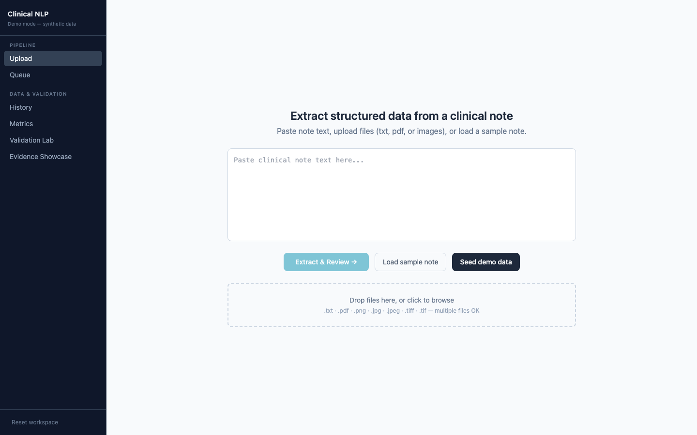
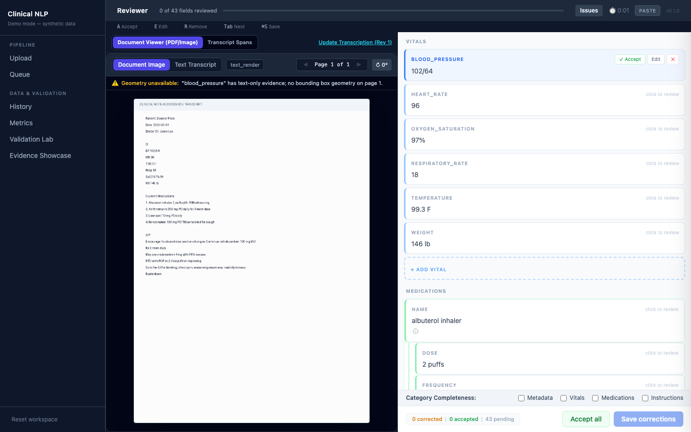
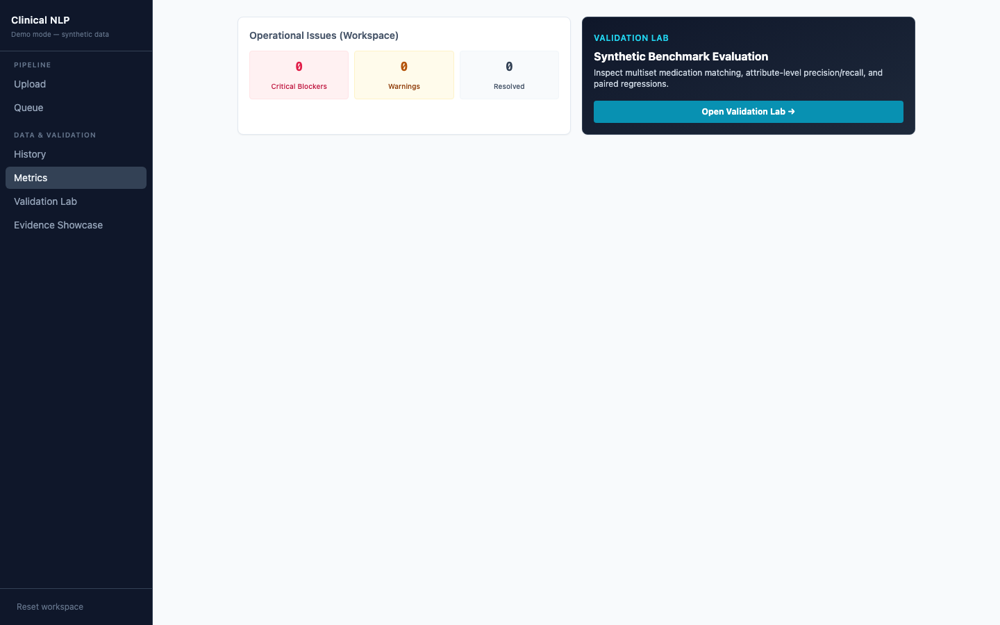
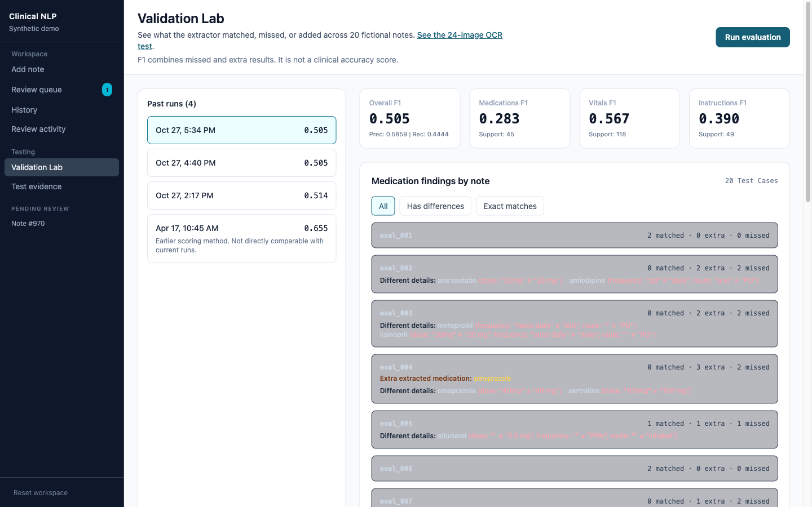
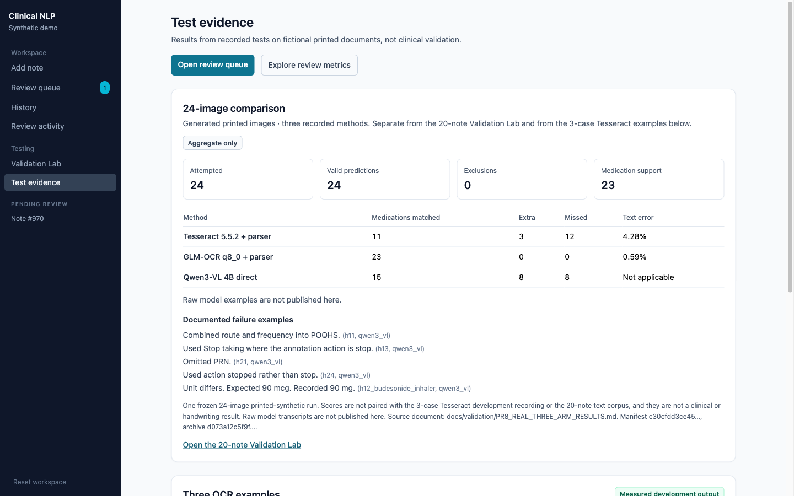

# Clinical Notes NLP Assistant

Synthetic clinical notes are easy to turn into structured fields and easy to trust too quickly. This workbench extracts medications, vitals, instructions, and metadata with deterministic rules, checks those proposals independently, and keeps a human review bound to the exact source revision.

The intended user is a synthetic reviewer or an engineer inspecting the workflow. It is not a clinician tool, not an EHR, and not a prescribing system.

The core extraction is rule-based. An optional local model or paid explainer never becomes the authority for a completed review. Independent checks exist because a plausible dose, span, or benchmark score can still be wrong: a decimal can move, two orders of the same drug can be collapsed, or a completed review can be replayed against a newer source.

The main engineering contribution is the lineage from source asset to note revision, extraction, independent check, review event, and current review state, including optimistic concurrency and idempotency.

> **Synthetic engineering demo — not for clinical use.** Do not submit real patient information. This project is not clinically validated and does not claim HIPAA compliance.

The canonical demonstration is a local build plus the recorded synthetic walkthrough in [`docs/validation/demo-script.md`](docs/validation/demo-script.md). A previously hosted URL is not guaranteed to run this commit, and this repository does not treat it as the v1 release. Auto-deploy remains disabled for `main` and for `feat/clinical-nlp-v1-release`.

## Product walkthrough

The sidebar uses these names. The routes are unchanged.

1. **Add note.** Paste a synthetic note, load the built-in sample, seed demo notes, or add a TXT, PDF, or typed image. OCR uses Tesseract for scanned or printed inputs.
2. The deterministic extractor identifies metadata, vitals, medication mentions, and instructions, and keeps a link back to the source where it has one.
3. **Review note.** Compare each extracted field with the source note, then accept, edit, or remove it. **Accept remaining** checks only fields that are still unchecked. **Save review** still requires the four acknowledgments under Before finishing. Pasted text stays text. A page image appears only when the note has one.
4. **Review queue** and **History** list notes in this browser workspace. **Review activity** summarizes corrections. Those counts are reviewer activity, not extraction accuracy.
5. **Validation Lab** is the 20 fictional notes. **Test evidence** is the separate 24-image comparison and the three recorded Tesseract examples. F1 on the lab page combines missed and extra results. It is not a clinical accuracy score, and the two tests are not combined.
6. Optionally inspect a local-dictionary explanation of a medication or abbreviation. An external AI terminology explanation is a separate, on-demand feature when configured; it is **not** the extraction engine.

| Add note | Review note | Review activity |
|:---:|:---:|:---:|
|  |  |  |

| Validation Lab | Test evidence |
|:---:|:---:|
|  |  |

Other views: [Review queue](docs/screenshots/queue.png), [History](docs/screenshots/history.png), and [Terminology explainer](docs/screenshots/explainer.png). These pictures are the current local interface.

## How it works

```text
Synthetic text / TXT / PDF / typed image
         |
         v
Flask upload/paste API
  |-- PyMuPDF text extraction / Tesseract OCR fallback
  |-- text normalization + custom regex section detection
  |-- deterministic vitals, medication, instruction, metadata extraction
  |      (regex and spaCy/medSpaCy matching/context rules)
         |
         v
SQLAlchemy persistence (SQLite local; configurable PostgreSQL)
         |
         v
React + TypeScript review interface
Add note --> Review queue --> Review note --> History --> Review activity
Validation Lab and Test evidence stay on their own pages

Optional, separate path:
dictionary explanation --> configured field-level AI explanation
```

The core NLP pipeline is **rule-based**, not an LLM note extractor. It uses a custom regex section detector, rather than spaCy's Sectionizer. The optional AI explainer is not required to process or review notes and is disabled when no API key is set.

### Engineering tradeoffs

- **Inspectability over black-box output:** structured fields can be compared with the original synthetic source, but a matching span alone does not prove a correct medication interpretation.
- **Human review is explicit:** a correction represents a user's action. A low correction rate does **not** establish high extraction accuracy; unnoticed omissions and reviewer error remain possible.
- **Bounded prototype scope:** the demo deliberately avoids real patient workflows, EHR integration, treatment recommendation, and claims of regulatory or privacy compliance.

## Run locally

Prerequisites: Python 3.11, a compatible Node.js version (Node 20 is a practical default), and Tesseract + Poppler for scanned PDFs/images.

```bash
# macOS OCR dependencies
brew install tesseract poppler

git clone https://github.com/KanujVerma/clinical-notes-nlp-assistant.git
cd clinical-notes-nlp-assistant
git switch main

python3.11 -m venv .venv
source .venv/bin/activate
python -m pip install -r requirements.txt
python -m pip install 'pillow==10.4.0'

cd frontend
npm ci
cd ..
```

Start the full local workbench (Flask, Vite and **one durable processing worker**) with:

```bash
make dev
# http://127.0.0.1:5173
```

The local AI panel now queues source/extraction-bound jobs and polls the worker. Without a running worker, requests remain queued; Flask itself does **not** run inference. Launch Ollama separately only when testing an installed, free local model. The two vision adapters require an original synthetic PDF/image, and neither their output nor visual-coordinate suggestions can automatically approve review data.

If running services separately, open three terminals:

```bash
.venv/bin/python backend/app.py       # Flask on port 5000
.venv/bin/python backend/worker.py    # one local processing worker
cd frontend && npm run dev            # Vite on port 5173
```

Open <http://localhost:5173>. Vite proxies `/api` to the local Flask backend. Without `DATABASE_URL`, the backend uses a local SQLite database. Seed synthetic notes with the **Seed demo data** button or use **Load sample note**. No API keys are needed.

**Optional AI explainer:** External paid inference is disabled by default. To explicitly enable it locally, set `ENABLE_EXTERNAL_EXPLAINER=true` AND configure `ANTHROPIC_API_KEY`; keep both disabled for offline processing. A pre-existing API key alone cannot enable provider calls. Keep it unset for offline extraction/review testing. Never send actual patient data to this demo or to the optional provider.

**Docker Compose (development):** `docker compose up --build` starts the backend on port **5000** and Vite on **5173**, but the two-service Compose configuration does **not** start the local worker or enable AI inference. Use `make dev` for the complete local workbench.

## Review controls

| Key | Action |
|---|---|
| `A` | Accept focused field |
| `E` | Edit |
| `R` | Remove |
| `Tab` / `Shift+Tab` | Navigate fields |
| `Esc` | Deactivate |
| `⌘S` / `Ctrl+S` | Save |

The review screen shows medications, vitals, instructions, and metadata by those names. A medication mention without a dose or directions is labeled Mention only. **Edit source** changes the note text and starts a new version. That does not make the previous review current.

## Validation Workbench & Verification Architecture

In addition to the baseline pipeline, this repository includes the **Clinical NLP Validation Workbench** (`docs/validation/`), establishing immutable lineage, defensive verification, and statistical evaluation:

- **Immutable Lineage & Append-Only Event Store**: Ingestion hashes source assets into content-addressed storage (SHA-256). Transcription edits create an incremented `NoteRevision` chain. Review events cite parent pointers, lock versions (optimistic concurrency), and idempotency keys.
- **Independent Quality Canaries**: Pure validation rules independently check extracted entities for half-open interval coordinate bounds, exact quote integrity (`A08`), decimal dose formatting risks (`A09`), duplicate medication conflicts (`A02`), missing vital units (`A03`), and contradictory instructions (`A04`).
- **Operational Issues Drawer**: Live slide-out drawer surfacing canaries and critical blockers with explicit reviewer disposition lifecycles.
- **Validation Lab (`/validation-lab`)**: The 20-note text evaluation. The page says matched, extra, and missed. The scorer is still source-occurrence-first, then a bounded assignment, not the Hungarian algorithm. It compares annotated medication attributes (`name`, `dose`, `route`, `frequency`, `duration`, `qualifier`). F1 on this page is not clinical accuracy and is not the 24-image test.
- **Test evidence (`/showcase`)**: The frozen 24-image comparison first, then documented failures and the separate three-case Tesseract recording. Qwen text error is not applicable. Raw model transcripts for the 24-image run are not published on the page.
- **Checksummed Export**: Downloadable review ZIPs with structured decisions, source lineage, and a SHA-256 file manifest. Checksums are not clinician signatures or independent proof of correctness.

Comprehensive documentation is available in [`docs/validation/`](docs/validation/):
- [Acceptance Matrix (A01–A48)](docs/validation/acceptance-matrix.md)
- [System Architecture](docs/validation/architecture.md)
- [API Contract](docs/validation/api-contract.md)
- [Requirements & Boundaries](docs/validation/requirements.md)
- [Engineering Demonstration Script](docs/validation/demo-script.md)
- [Contribution Changelog](docs/validation/contribution-changelog.md)
- [30-case Real Vision Benchmark Audit](docs/validation/THIRTY_CASE_BENCHMARK_AUDIT.md)
- [Medication Parser Gold/OCR Replay](docs/validation/MEDICATION_GOLD_REPLAY.md)

## Verification

From the repository root, after the setup above:

```bash
make verify-release
```

That command runs backend tests, disposable PostgreSQL migration/concurrency tests, frontend unit tests, lint, the production build, restart persistence, and the frozen benchmark archive hash check. It writes `artifacts/verification/v1-release-<sha>/summary.json`, which is gitignored.

Browser coverage, with Flask and Vite started by the script when those ports are free:

```bash
.venv/bin/python scripts/verify_v1_release.py --with-browser
```

Individual commands match CI: `make backend-tests`, `make frontend-tests`, `npm run lint --prefix frontend`, `npm run build --prefix frontend`, and `make browser-tests`. PostgreSQL tests fail closed when `REQUIRE_POSTGRES=1` and no disposable binaries are available. They do not use a live database.

## Known limitations and operational boundaries

- **Synthetic only:** The system is restricted to synthetic, de-identified clinical scenarios. It is not HIPAA-certified, does not connect to EHRs, does not verify patient identity, and must never be used for real clinical decision-making.
- **Extraction bounds:** Ambiguous clinical phrasing, novel abbreviations, and unformatted narrative text require human verification. The deterministic pipeline flags anomalies via canaries rather than making autonomous clinical decisions.
- **Optional local AI:** On-device GLM-OCR and Qwen3-VL adapters exist. PR #5 records real local inference on 30 hash-pinned generator-derived printed/noisy/photographed-effect synthetic images, **not** handwriting or an independent holdout. Model suggestions remain separate from reviewer-approved state. Vision requests without an original image source fail closed; paid terminology explanation stays opt-in.
Measured evidence stays in separate tiers. Do not pool them.

| Tier | What it is | What it is not |
|---|---|---|
| Unit and regression fixtures | Deterministic checks, including `data/validation_loop/` | A benchmark |
| 20-note development corpus | Validation Lab text evaluation | The 24-image vision run |
| 3-case Tesseract recording | Published development OCR transcripts on `/showcase` | The 24-image comparison |
| Frozen 24-image printed-synthetic run | Documented aggregate in [`PR8_REAL_THREE_ARM_RESULTS.md`](docs/validation/PR8_REAL_THREE_ARM_RESULTS.md), shown on `/showcase` without raw transcripts | Handwriting accuracy or clinical validation |
| Earlier local model archives | Historical development runs such as `artifacts/evaluation/paired_local_17f5737320b78e10.json` | A paired replacement for the frozen 24-image scores |
| Clinical validation | Not conducted | — |

Medication matching is source-occurrence-first, then a bounded one-to-one assignment. It is not the Hungarian algorithm. Duplicate drug names stay separate so the scorer cannot trade a wrong dose for a higher F1. Empty support is N/A. OCR CER/WER is reported only for arms that produced transcription text. Correction counts measure reviewer activity, not extraction accuracy. A synthetic F1 score does not establish clinical safety.
- **Release status:** GitHub Actions verifies synthetic/offline and hosted-mode contracts on each changed PR head. The [acceptance matrix](docs/validation/acceptance-matrix.md) contains historical verification snapshots; production deployment, migrations, EHR integration, and handling actual patient information remain unapproved.

## Project scope and contributions

This repository is an engineering exercise in structured extraction, reviewer UX, deterministic testing, and learning from counterexamples using **synthetic data only**. The original application and any later AI-assisted reliability enhancements should remain distinguishable through commit history and dated implementation evidence. Automated code review is not a substitute for human or clinical review.

See `backend/extractors/`, `backend/evaluation/`, `backend/tests/`, `frontend/src/pages/`, and `frontend/e2e/` for the implementation and test entry points.
