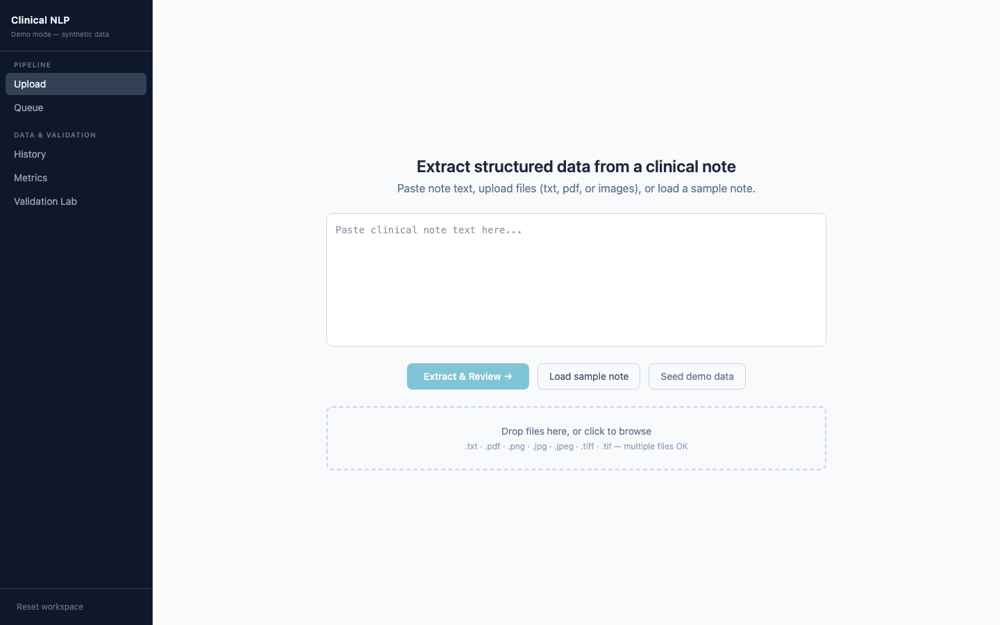
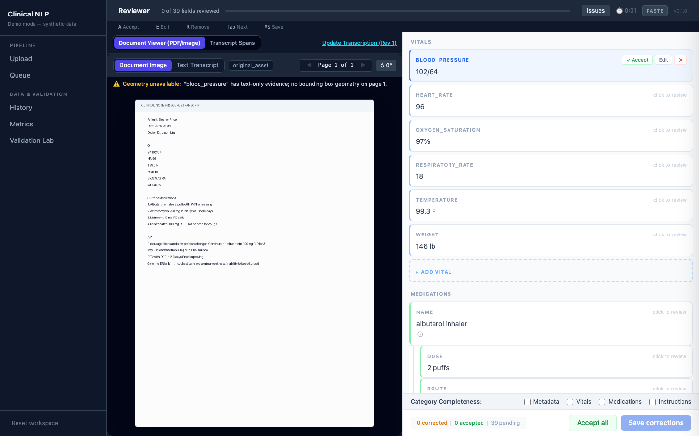
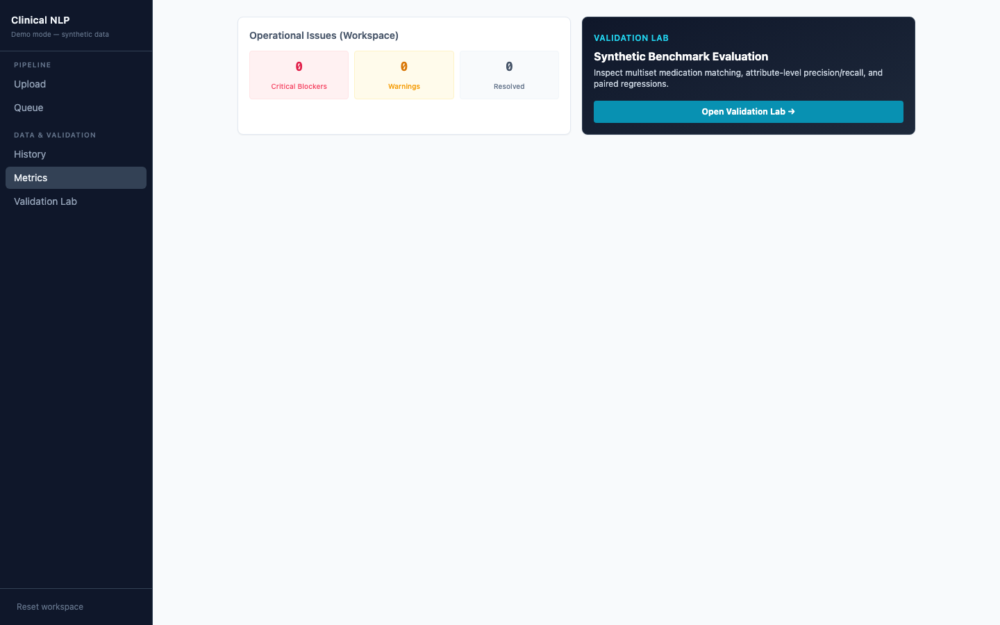

# Clinical Notes NLP Assistant

A **full-stack, synthetic clinical-note extraction and human-review prototype** built with React, TypeScript, Flask, SQLAlchemy, spaCy/medSpaCy, and deterministic rules. It extracts structured fields, lets a reviewer inspect and correct them against the source, and records reviewer activity.

> **Draft feature branch — undergoing independent verification.** Validation-workbench changes have not been merged to `main` or verified in the hosted deployment. The recorded local test counts precede more recent source edits and are not a release certificate.

> **Synthetic engineering demo — not for clinical use.** Do not submit real patient information. This is not clinically validated, does not verify patient identity, and is not an EHR or prescribing tool. Session-based workspace separation is not authentication.

**Hosted demo:** [clinical-nlp.vercel.app](https://clinical-nlp.vercel.app/) (availability and deployment version are not guaranteed by this README). For reproducible behavior, run the checked-out revision locally.

## Product walkthrough

1. Paste a synthetic note, load the built-in sample, seed demo notes, or upload TXT, PDF, or a typed image. OCR uses Tesseract for scanned/printed inputs.
2. The deterministic extractor identifies metadata, vitals, medication mentions and instructions, retaining source-linked field information where available.
3. Review each extracted field, accept/edit/remove it, and save. The keyboard-oriented interface supports repeated inspection and correction.
4. Browse the queue and review history. The Metrics view summarizes reviewer corrections and activity within the current browser workspace.
5. Optionally inspect a local-dictionary explanation of a medication or abbreviation. An external AI terminology explanation is a separate, on-demand feature when configured; it is **not** the extraction engine.

| Upload | Review | Metrics |
|:---:|:---:|:---:|
|  |  |  |

Other interface views: [Queue](docs/screenshots/queue.png), [History](docs/screenshots/history.png), and [Terminology explainer](docs/screenshots/explainer.png). Screenshots may describe the recorded UI state rather than the currently deployed build.

## How it works

```text
Synthetic text / TXT / PDF / typed image
         |
         v
Flask upload/paste API
  |-- PyMuPDF text extraction / Tesseract OCR fallback
  |-- text normalization + custom regex section detection
  |-- deterministic vitals, medication, instruction, metadata extraction
  |      (regex and spaCy/medSpaCy matching/context rules)
         |
         v
SQLAlchemy persistence (SQLite local; configurable PostgreSQL)
         |
         v
React + TypeScript reviewer UI
Upload --> Queue --> Review --> History --> Metrics

Optional, separate path:
dictionary explanation --> configured field-level AI explanation
```

The core NLP pipeline is **rule-based**, not an LLM note extractor. It uses a custom regex section detector, rather than spaCy's Sectionizer. The optional AI explainer is not required to process or review notes and is disabled when no API key is set.

### Engineering tradeoffs

- **Inspectability over black-box output:** structured fields can be compared with the original synthetic source, but a matching span alone does not prove a correct medication interpretation.
- **Human review is explicit:** a correction represents a user's action. A low correction rate does **not** establish high extraction accuracy; unnoticed omissions and reviewer error remain possible.
- **Bounded prototype scope:** the demo deliberately avoids real patient workflows, EHR integration, treatment recommendation, and claims of regulatory or privacy compliance.

## Run locally

Prerequisites: Python 3.11, a compatible Node.js version (Node 20 is a practical default), and Tesseract + Poppler for scanned PDFs/images.

```bash
# macOS OCR dependencies
brew install tesseract poppler

git clone https://github.com/KanujVerma/clinical-notes-nlp-assistant.git
cd clinical-notes-nlp-assistant
git switch feat/clinical-validation-workbench

python3.11 -m venv .venv
source .venv/bin/activate
python -m pip install -r requirements.txt

cd frontend
npm ci
cd ..
```

Open two terminals from the repository root:

```bash
# Terminal 1 — Flask
source .venv/bin/activate
cd backend
python app.py
# http://localhost:5000
```

```bash
# Terminal 2 — Vite
cd frontend
npm run dev
# http://localhost:5173
```

Open <http://localhost:5173>. Vite proxies `/api` to the local Flask backend. Without `DATABASE_URL`, the backend uses a local SQLite database. Seed synthetic notes with the **Seed demo data** button or use **Load sample note**. No API keys are needed.

**Optional AI explainer:** External paid inference is disabled by default. To explicitly enable it locally, set `ENABLE_EXTERNAL_EXPLAINER=true` AND configure `ANTHROPIC_API_KEY`; keep both disabled for offline processing. A pre-existing API key alone cannot enable provider calls. Keep it unset for offline extraction/review testing. Never send actual patient data to this demo or to the optional provider.

**Docker Compose (development):** `docker compose up --build` starts the backend on port **5000** and the Vite frontend on port **5173**. The Compose configuration is a two-service development environment; it does not serve the whole application solely at port 5000.

## Review controls

| Key | Action |
|---|---|
| `A` | Accept focused field |
| `E` | Edit |
| `R` | Remove |
| `Tab` / `Shift+Tab` | Navigate fields |
| `Esc` | Deactivate |
| `⌘S` / `Ctrl+S` | Save |

The reviewer can inspect medications, vitals, instructions, and metadata. Medication mentions without sufficient structured directions require human interpretation rather than assuming they are active treatment instructions.

## Validation Workbench & Verification Architecture

In addition to the baseline pipeline, this branch includes the **Clinical NLP Validation Workbench** (`docs/validation/`), establishing immutable lineage, defensive verification, and statistical evaluation:

- **Immutable Lineage & Append-Only Event Store**: Ingestion hashes source assets into content-addressed storage (SHA-256). Transcription edits create an incremented `NoteRevision` chain. Review events cite parent pointers, lock versions (optimistic concurrency), and idempotency keys.
- **Independent Quality Canaries**: Pure validation rules independently check extracted entities for half-open interval coordinate bounds, exact quote integrity (`A08`), decimal dose formatting risks (`A09`), duplicate medication conflicts (`A02`), missing vital units (`A03`), and contradictory instructions (`A04`).
- **Operational Issues Drawer**: Live slide-out drawer surfacing canaries and critical blockers with explicit reviewer disposition lifecycles.
- **Synthetic Evaluation Lab (`/validation-lab`)**: Deterministic source-occurrence-first medication pairing with a bounded assignment fallback (not the Hungarian algorithm), evaluating annotated medication attributes (`name`, `dose`, `route`, `frequency`, `duration`, `qualifier`) and case-by-case error attribution (TP/FP/FN).
- **Checksummed Export**: Downloadable review ZIPs with structured decisions, source lineage, and a SHA-256 file manifest. Checksums are not clinician signatures or independent proof of correctness.

Comprehensive documentation is available in [`docs/validation/`](docs/validation/):
- [Acceptance Matrix (A01–A48)](docs/validation/acceptance-matrix.md)
- [System Architecture](docs/validation/architecture.md)
- [API Contract](docs/validation/api-contract.md)
- [Requirements & Boundaries](docs/validation/requirements.md)
- [Engineering Demonstration Script](docs/validation/demo-script.md)
- [Contribution Changelog](docs/validation/contribution-changelog.md)

## Verification

From the repository root:

```bash
# Backend pytest suite (rerun and record counts for this exact commit)
source .venv/bin/activate
python -m pytest backend/tests/ -q

# Frontend unit tests, linting, and build
cd frontend
npm test
npm run lint
npm run build

# End-to-end browser tests (counts depend on checked-out revision)
# Requires Flask (port 5000) and Vite (port 5173) running:
npx playwright test
```

## Known limitations and operational boundaries

- **Synthetic only:** The system is restricted to synthetic, de-identified clinical scenarios. It is not HIPAA-certified, does not connect to EHRs, does not verify patient identity, and must never be used for real clinical decision-making.
- **Extraction bounds:** Ambiguous clinical phrasing, novel abbreviations, and unformatted narrative text require human verification. The deterministic pipeline flags anomalies via canaries rather than making autonomous clinical decisions.
- **Optional local AI:** This branch includes GLM-OCR and Qwen3-VL image-input adapters as well as text-only suggestions. All model outputs remain proposals, separate from reviewed state. The unit tests use mocked model responses; no actual on-device handwriting accuracy benchmark has been verified. Vision requests without an original image source now fail closed. Paid terminology explanation remains disabled without explicit opt-in.
- **Live synthetic OCR benchmark:** To measure a real installed model, create a hash-pinned synthetic image/ground-truth manifest and run `python backend/evaluation/vision_benchmark.py --manifest data/vision_gold/manifest.json`. The previously reported handwritten CER/WER values came from handcrafted example strings, NOT model inference; do not cite them as observed model performance.
- **Evaluation limits:** The historical 20-note synthetic corpus was inspected during development and is not a held-out or clinically adjudicated set. Older saved benchmark artifacts use earlier matching rules and cannot be treated as a comparable strict baseline.
- **Release status:** The [acceptance matrix](docs/validation/acceptance-matrix.md) records pending final-SHA verification; project readiness, migration compatibility and browser UX should not be inferred from a passing old smoke suite.

## Project scope and contributions

This repository is an engineering exercise in structured extraction, reviewer UX, deterministic testing, and learning from counterexamples using **synthetic data only**. The original application and any later AI-assisted reliability enhancements should remain distinguishable through commit history and dated implementation evidence. Automated code review is not a substitute for human or clinical review.

See `backend/extractors/`, `backend/evaluation/`, `backend/tests/`, `frontend/src/pages/`, and `frontend/e2e/` for the implementation and test entry points.
